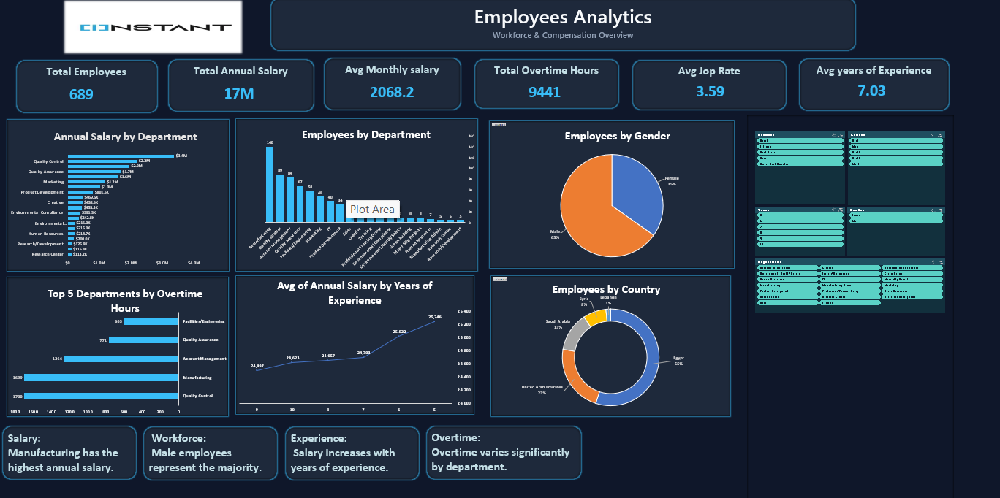

# 👥 HR Employees Analytics Dashboard

**An Interactive Workforce & Compensation Dashboard Built with Microsoft Excel**

An interactive HR dashboard that analyzes workforce size, salaries, overtime, and experience across departments, countries, and genders.

## 📈 Key Metrics

| KPI | Value |
|---|---|
| Total Employees | 689 |
| Total Annual Salary | 17M |
| Avg Monthly Salary | 2,068.2 |
| Total Overtime Hours | 9,441 |
| Avg Job Rate | 3.59 |
| Avg Years of Experience | 7.03 |

## 📊 Dashboard Visualizations

1. **Annual Salary by Department**
2. **Employees by Department**
3. **Employees by Gender**
4. **Top 5 Departments by Overtime Hours**
5. **Avg Annual Salary by Years of Experience**
6. **Employees by Country**

## 🎛️ Interactive Features

Slicers for **Country**, **Region**, **Years of Experience**, **Gender**, and **Department** let users filter the whole dashboard.

## 💡 Key Insights

- Manufacturing has the highest annual salary.
- Male employees represent the majority of the workforce.
- Salary increases with years of experience.
- Overtime varies significantly by department.

## 🛠️ Tools

- Microsoft Excel (PivotTables, PivotCharts, Slicers)
- Figma (dashboard wireframe)

## 📁 Files

- `HR_excel.xlsx`: Excel workbook with the data and dashboard
- `HR_Dashboard.png`: dashboard preview

## 👤 Author

**Abdelrahman Magdy**

 
